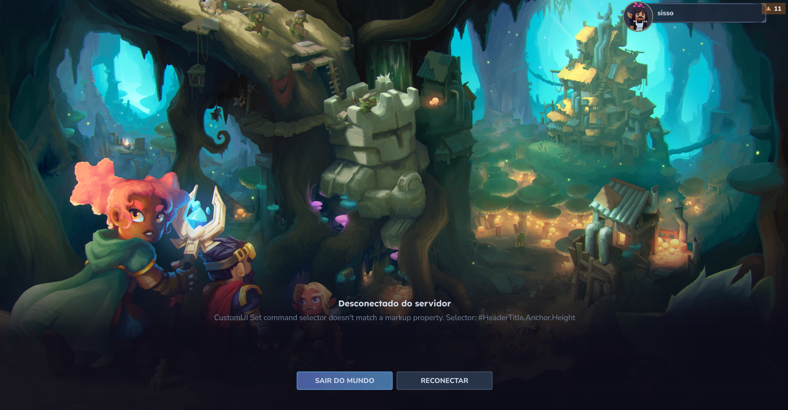

# Classroom — turmas e administração

Disponível na candidata **1.4.0-rc.20**, Hytale **0.7.4**. Turmas, solicitações, convites, matrícula, membros, mensagem do dia, permissões automáticas e encerramento estão implementados. Este guia descreve o comportamento atual; [atividades, entregas e correção](classroom-learning.md) têm guia próprio.

Os fluxos administrativos centrais e o funcionamento em multiplayer foram confirmados nos relatos anteriores. O polimento rc.14 foi aprovado por relato, sem discriminar toda a matriz de idiomas/escalas. O [estado de validação](validation.md) preserva os resultados por build; o [roteiro da candidata](classroom-acceptance.md) orienta a regressão atual. Critérios e verificação assistida da rc.15 ainda exigem aceite específico de interação.

## Instalar e autorizar

Compile com `.\gradlew.bat build`. Com o mundo/servidor parado, instale apenas `build/libs/LogicGates-1.4.0-rc.20.jar` na pasta `mods`, substituindo a versão anterior, e reinicie para recarregar assets. O ZIP em `build/releases/LogicGates-1.4.0-rc.20.zip` inclui o mesmo JAR, checksum, identificação da compilação, documentação e fontes de arte; guarde-o fora de `mods`. Se recebeu somente o ZIP, extraia apenas o JAR de produção para instalar. Preserve os mundos e faça backup antes de atualizar o banco. A rc.15 migra para o esquema v6 com backup automático antes da alteração; não apague os dados. Para voltar à rc.14, restaure o banco v5 compatível do backup. Entregas precisam de backup conjunto de `classroom.db` e `submissions`. Para retornar à rc.10, restaure o banco v4 do backup. Para voltar à rc.8 ou anterior, restaure também o banco compatível do backup, com o servidor parado.

Qualquer jogador no mundo pode abrir `/classroom`. O servidor verifica a permissão nativa em cada operação docente, junto da responsabilidade pela turma. No console:

```text
perm user add <UUID> sisso.logicgates.classroom.teach
perm user remove <UUID> sisso.logicgates.classroom.teach
```

Cada UUID possui **um único vínculo ativo no servidor**, professor ou aluno. A autorização docente não ocupa esse vínculo. Uma conta com permissão pode solicitar ingresso como aluno enquanto estiver sem vínculo; nesse caso, não poderá criar outra turma enquanto o vínculo estiver ativo. A perda da permissão preserva a turma e bloqueia operações docentes.

## Professor

Sem vínculo, use **Criar turma**. Nome obrigatório, 1–64 caracteres; descrição opcional de até 2048. Após criar, a abertura seguinte entra diretamente na própria turma.

- **Turma:** lista de alunos à esquerda. Selecione um para consultar nome, UUID, matrícula e data de ingresso UTC; corrija matrícula ou remova com confirmação. A visão geral mostra descrição e mensagem.
- **Ingressos:** processos abertos da sua turma. Solicitações aguardam conferência; o professor pode corrigir a matrícula antes de aprovar ou rejeitar. Convites ainda não aceitos podem ser cancelados.
- **Convidar jogador:** pesquisa jogadores conhecidos pelo Classroom, incluindo offline. Nome é apresentação; a seleção conserva o UUID. Jogadores já vinculados não são elegíveis.
- **Administração:** nome, descrição e mensagem do dia são salvos juntos, em uma transação e revisão. Mensagem opcional de até 2048 caracteres; vazia suprime apresentação/envio. Também permite encerrar a turma com confirmação.

As listas exibem até 20 registros por página. Sem registros e sem seleção em edição, o rodapé orienta a próxima ação conforme a seção. Uma página posterior vazia orienta voltar por Anterior; confirmação, atualização e mensagens explícitas de erro/gravação/resultado conservam prioridade. O registro selecionado recebe uma marca lateral. Nomes e matrículas longos podem ser resumidos na lista; a ficha/editor conserva seu conteúdo completo. Matrícula, confirmação e Salvar ficam fora da área rolável dos detalhes. Isso não limita o tamanho da turma. Não há remoção automática por ausência, promoção de outro professor ou exclusão definitiva de histórico. O encerramento administrativo está disponível desde a rc.9.

## Aluno e ingresso

Sem turma, **Encontrar turmas** oferece resumos públicos com nome, descrição e professor. Pesquise, selecione uma turma, informe matrícula e use **Solicitar ingresso**. Não há ingresso imediato.

Em **Ingressos**, o jogador acompanha os próprios processos, inclusive estados encerrados, com tipo e data/hora de criação UTC. Um processo aprovado no histórico não significa que seu vínculo permaneça ativo. Para convite, aceitar e informar matrícula também encaminha para conferência do professor. Recusa e cancelamento encerram o processo. Solicitação e convite para a mesma turma convergem para uma pendência; repetição não sobrescreve a matrícula que já está sob conferência.

A matrícula é textual, de 1 a 64 caracteres, sem controles/quebras de linha. Remove apenas espaços nas extremidades e preserva zeros, caixa e conteúdo interno válido: `00123` permanece `00123`. Sua unicidade considera alunos ativos da turma, com comparação exata; `001a` e `001A` são diferentes. Pendências não reservam matrícula.

A aprovação revalida permissão, responsabilidade, processo, matrícula e vínculo na transação. A primeira aprovação ou criação de turma docente encerra as demais pendências do UUID. Convites sobrevivem ao reinício, sem expiração automática. Uma aprovação repetida não cria outro vínculo.

Vinculado, o aluno consulta a própria turma e ficha, incluindo mensagem do dia. Matrículas de colegas e pendências de outras pessoas não são fornecidas. **Sair da turma** exige confirmação. Saída/remoção encerra o vínculo e conserva histórico; novo ingresso precisa de novo processo e vínculo. Uma confirmação antiga não remove o vínculo novo.

## Atualizações e conexão

Atualizações após commit alcançam as páginas interessadas. Campos de edição e revisões apresentados ao usuário são preservados durante atualizações automáticas. Uma gravação desatualizada recebe erro; copie os campos e use **Recarregar** para revisar os dados. Recarregar, navegar e selecionar outro registro substituem os respectivos campos; não há salvamento automático.

Desde a rc.5, alterações de autorização feitas pelos comandos/APIs nativas também revalidam páginas abertas: permissões individuais, vínculos de grupo/OP e permissões de grupo. Não há consulta periódica. Na rc.8, o despacho é indexado por UUID e alterações sem mudança da autorização efetiva não reconsultam a página. Eventos de grupo percorrem cada conta com página aberta uma vez. A revalidação bloqueia ações, descarta respostas antigas e aplica a permissão efetiva atual. Revogar autorização docente descarta o rascunho e oculta o painel; restaurar carrega os dados persistidos sem exigir Recarregar. Se a autorização continuar igual, o rascunho é preservado. Edições externas de arquivos ou provedores que não emitem eventos continuam dependendo da próxima interação/recarga, com validação no servidor em cada operação. Esses eventos não reenviam a mensagem do dia.

O transporte conserva linhas e bindings quando os registros permanecem iguais, enviando apenas propriedades alteradas. Recarregar e limpar campos na revogação continuam enviando seus valores explicitamente, inclusive valores vazios iguais ao último envio, pois o usuário pode ter editado localmente. Respostas sem alterações ainda enviam a confirmação exigida pelo cliente nativo.

Fechar/dispensar não cancela uma gravação aceita. Sua resposta não atualiza outra página. Ao concluir, a alteração pode ser vista na próxima abertura. Desconexão limpa listeners da conta; callbacks também conferem referência, mundo, conexão e página ativa.

A mensagem do dia aparece no painel e é enviada em chat privado após o primeiro PlayerReadyEvent de cada conexão, quando preenchida e o vínculo permite acesso. Trocar de mundo não repete a mensagem. Reconectar cria nova sessão. Mudanças de vínculo/turma invalidam mensagens antigas ainda enfileiradas. Os nomes conhecidos são atualizados por conexão e ao abrir Classroom.

O idioma usa i18n nativa en-US/pt-BR. Textos de usuários são literais. `/classroom --probe` mantém o contador diagnóstico, que reinicia a cada abertura.

## Dados, migração e backup

O log informa `Classroom database: <caminho absoluto>`. Há um `classroom.db` por servidor em `getDataDirectory()`, compartilhado entre mundos. SQLite JDBC 3.53.4.0 e recursos nativos/licenças já estão no JAR. Em execução direta Java 25, use `--enable-native-access=ALL-UNNAMED` antes de `-jar`.

O esquema atual é **v6**: v1 introduziu turma e vínculo docente; v2, diretório, processos, matrícula e histórico; v3, mensagem; v4, encerramento e unicidade do professor limitada a turmas abertas; v5, atividades, entregas, avaliações e reservas; v6, critérios versionados de verificação assistida. A atualização preserva IDs, nome, descrição e revisões existentes. Antes de migrar um banco identificado, guarda uma cópia consistente em `backups/classroom-v<versão>-<UUID>.db` no diretório do plugin, por VACUUM INTO. As alterações de esquema são transacionais. Estruturas incompatíveis ou incompletas tornam Classroom indisponível sem substituir o arquivo; circuitos continuam registrados.

Antes de instalar uma atualização, encerre o servidor normalmente e copie o diretório completo do plugin para uma pasta externa a `build/`. Para restaurar, mantenha o servidor parado, preserve o estado atual e restaure o backup completo. Não copie somente o arquivo principal de um banco ativo. Uma versão antiga do plugin pode recusar o esquema novo; para rollback, restaure o banco da versão correspondente. Um banco de versão anterior compatível é migrado novamente ao abrir na versão atual, preservando identidades. Entregas exigem restaurar banco e arquivos privados conjuntamente; veja [persistência pedagógica](classroom-learning.md#persistência-e-recuperação).

## Encerrar uma turma

Na aba **Administração**, o professor responsável pode selecionar **Encerrar turma**. A confirmação informa que todos os participantes serão liberados e os ingressos pendentes cancelados. **Cancelar** conserva a turma e os campos ainda não salvos; **Confirmar encerramento da turma** efetiva a operação. Não é necessário remover cada aluno antes.

O servidor revalida permissão docente, responsabilidade, UUID e revisão da turma. O encerramento é uma única transação: registra a data, encerra todos os vínculos ativos e cancela somente processos pendentes. Nenhuma turma encerrada aceita novos ingressos ou aparece na descoberta. O professor volta à criação de turma, e os alunos à descoberta, com atualização automática das páginas abertas relacionadas. Todos podem estabelecer outro vínculo; uma confirmação antiga não encerra a nova turma.

O histórico é mantido no banco: conteúdo da turma, matrículas, datas, vínculos encerrados e processos anteriores. O histórico pessoal de ingressos continua mostrando aprovações passadas como processos, sem indicar vínculo ativo. Não há botão para restaurar uma turma encerrada nem exclusão definitiva. A decisão de encerrar uma turma real deve ser tomada pelo seu professor; para validar o recurso, use uma turma de teste.

## Aceite e regressão

O **[documento único de aceite](classroom-acceptance.md)** reúne pendências, preparação, [roteiro administrativo](classroom-acceptance.md#roteiro-administrativo), teste com professor/aluno e massa isolada. Escolher os casos afetados pela mudança e atualizar seus resultados somente ali. Os registros abaixo conservam o contexto histórico; os contratos de uso permanecem neste guia.

## Evidências históricas

Em 24/10/2026, o usuário confirmou no build `1.4.0-rc.1+43804c498938`, pt-BR: abertura, dez cliques com atualização, fechamento e reabertura com reset.


Na mesma data, build `1.4.0-rc.2+a04a304d984f`, confirmou turma preservada após sair/entrar no mundo e usar Recarregar, além da regressão do contador. O relato não confirma separadamente en-US, revogação ou encerramento completo do processo.


Na mesma data, a abertura de `/classroom` no build instalado `1.4.0-rc.3+db6586d63971` desconectou o cliente com `CustomUI Set command selector doesn't match a markup property. Selector: #HeaderTitle.Anchor.Height`. A captura e o log do cliente confirmam falha de resolução do seletor. O JAR instalado correspondia ao pacote rc.3; o ZIP não foi a causa. A rc.4 envia o objeto `Anchor` completo para os dois títulos, descrição e mensagem, preservando margens. O fluxo central corrigido foi confirmado posteriormente; [evidências da rc.4](evidence/classroom/2026-10-24-rc4-client.md).



## O que a automação comprova

JUnit exercita serviços, SQLite, rollback, concorrência entre conexões, migração de esquema v1 congelado, backup/restauração, seleção por UUID, preservação de revisão/campos, codecs e comandos/bindings reais. O controle de conexão cobre reconexão, troca de mundo e invalidação de mensagens. Um classloader isolado executa JDBC somente a partir do JAR final.

As ferramentas conferem traduções, parâmetros, recursos, assets e conteúdo de JAR/ZIP. A integração nativa usa o serviço de produção e permissões Hytale para conferir matrícula, convite e mensagem após reinício, além das regressões consolidadas. Ela não abre páginas nem recebe cliques de um cliente. A CI portável Windows/Linux precisa aprovar a revisão enviada; execução local no Windows não equivale a resultado Linux.

Veja [arquitetura](architecture.md), [plano](roadmap/classroom.md), [referência PartyPro](reference/partypro.md) e [contratos pedagógicos](roadmap/classroom-learning-contracts.md).

As rodadas locais e os checksums estão no [registro de validação](validation.md), com [evidência nativa da rc.9](evidence/classroom/2026-10-24-rc9-server.json). A [falha de markup da rc.5](evidence/classroom/2026-10-24-rc5-client.md) permanece documentada. O [registro histórico de rc.3](validation.md#classroom-administrativo--rc3) separa sua aprovação automatizada da falha no cliente. Nenhuma evidência nativa substitui o roteiro de cliente.

## Acompanhamento por aluno — rc.17

Na aba **Turma**, cada aluno exibe **3/4 entregues**, por exemplo: três atividades com entrega entre quatro publicadas e não arquivadas. Atividades vencidas entram; rascunhos privados não entram. Reenvios não duplicam a contagem, e uma entrega de publicação anterior continua contando. Arquivar/ restaurar retira/recoloca a atividade; reingresso da mesma conta na mesma turma conserva seu histórico.

Selecionar o aluno abre sua ficha com atividades, situação, prazo e nota da revisão mais recente. Nota zero aparece como zero; uma revisão nova sem avaliação mostra **—**, mesmo que uma anterior tenha nota. Clicar na atividade abre a consulta/correção já nesse aluno. **Gerenciar aluno** separa correção de matrícula e remoção das informações de acompanhamento. UUID e data de ingresso ficam em **Dados técnicos**. A tela inicial oferece indicadores de publicadas, alunos e entregas aguardando avaliação; o aluno vê suas próprias entregas e pendências.

As atualizações de catálogo, entrega e nota são notificadas após confirmação no banco, filtradas por turma e agrupadas pela página. Não há consultas por aluno ao montar a lista, leitura de arquivos de circuito para contar, polling ou reenvio de mensagem do dia. Rascunhos e notas de outros alunos continuam privados.
