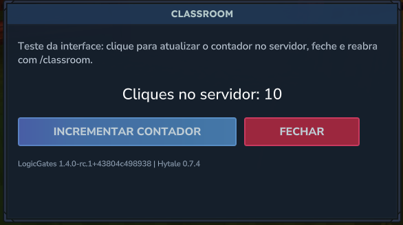
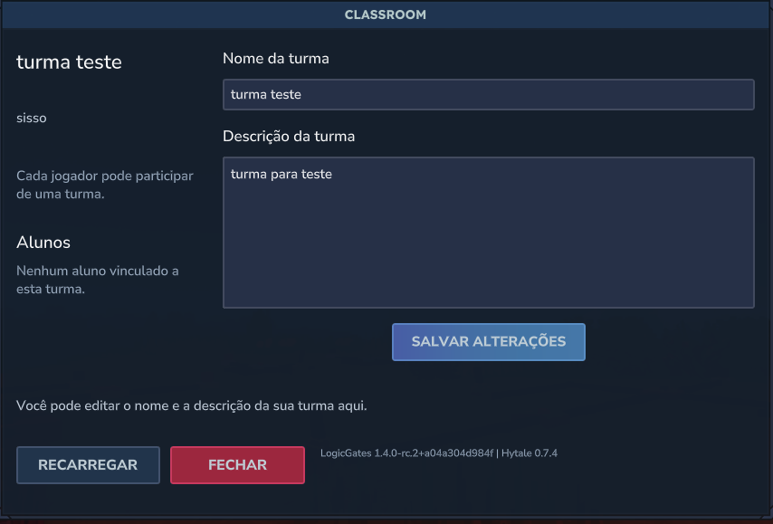

# Classroom — MVP administrativo e validação

Disponível em **1.4.0-rc.3**, Hytale **0.7.4**. Turmas, solicitações, convites, matrícula, membros e mensagem do dia estão implementados. **As novas telas aguardam validação no cliente com professor e aluno em en-US/pt-BR.** Os relatos de rc.1/rc.2 aprovam os cenários históricos abaixo, sem aprovar automaticamente esta compilação.

## Instalar e autorizar

Compile com `.\gradlew.bat build`. Instale apenas `build/libs/LogicGates-1.4.0-rc.3.jar` na pasta `mods`, substituindo a versão anterior, e reinicie para recarregar assets. O ZIP em `build/releases/LogicGates-1.4.0-rc.3.zip` inclui o JAR, checksum e documentação. Preserve os mundos e faça backup antes de atualizar o banco.

Qualquer jogador no mundo pode abrir `/classroom`. O servidor verifica a permissão nativa em cada operação docente, junto da responsabilidade pela turma. No console:

```text
perm user add <UUID> sisso.logicgates.classroom.teach
perm user remove <UUID> sisso.logicgates.classroom.teach
```

Cada UUID possui **um único vínculo ativo no servidor**, professor ou aluno. A autorização docente não ocupa esse vínculo. Uma conta com permissão pode solicitar ingresso como aluno enquanto estiver sem vínculo; nesse caso, não poderá criar outra turma enquanto o vínculo estiver ativo. A perda da permissão preserva a turma e bloqueia operações docentes.

## Professor

Sem vínculo, use **Criar turma**. Nome obrigatório, 1–64 caracteres; descrição opcional de até 2048. Após criar, a abertura seguinte entra diretamente na própria turma.

- **Turma:** lista de alunos à esquerda. Selecione um para consultar nome, UUID, matrícula e data de ingresso UTC; corrija matrícula ou remova com confirmação. A visão geral mostra descrição e mensagem.
- **Ingressos:** processos abertos da sua turma. Solicitações aguardam conferência; o professor pode corrigir a matrícula antes de aprovar ou rejeitar. Convites ainda não aceitos podem ser cancelados.
- **Convidar jogador:** pesquisa jogadores conhecidos pelo Classroom, incluindo offline. Nome é apresentação; a seleção conserva o UUID. Jogadores já vinculados não são elegíveis.
- **Administração:** nome, descrição e mensagem do dia são salvos juntos, em uma transação e revisão. Mensagem opcional de até 2048 caracteres; vazia suprime apresentação/envio.

As listas exibem até 20 registros por página. Isso não limita o tamanho da turma. Não há remoção automática por ausência, promoção de outro professor ou exclusão de turma neste MVP.

## Aluno e ingresso

Sem turma, **Encontrar turmas** oferece resumos públicos com nome, descrição e professor. Pesquise, selecione uma turma, informe matrícula e use **Solicitar ingresso**. Não há ingresso imediato.

Em **Ingressos**, o jogador acompanha os próprios processos, inclusive estados encerrados. Para convite, aceitar e informar matrícula também encaminha para conferência do professor. Recusa e cancelamento encerram o processo. Solicitação e convite para a mesma turma convergem para uma pendência; repetição não sobrescreve a matrícula que já está sob conferência.

A matrícula é textual, de 1 a 64 caracteres, sem controles/quebras de linha. Remove apenas espaços nas extremidades e preserva zeros, caixa e conteúdo interno válido: `00123` permanece `00123`. Sua unicidade considera alunos ativos da turma, com comparação exata; `001a` e `001A` são diferentes. Pendências não reservam matrícula.

A aprovação revalida permissão, responsabilidade, processo, matrícula e vínculo na transação. A primeira aprovação ou criação de turma docente encerra as demais pendências do UUID. Convites sobrevivem ao reinício, sem expiração automática. Uma aprovação repetida não cria outro vínculo.

Vinculado, o aluno consulta a própria turma e ficha, incluindo mensagem do dia. Matrículas de colegas e pendências de outras pessoas não são fornecidas. **Sair da turma** exige confirmação. Saída/remoção encerra o vínculo e conserva histórico; novo ingresso precisa de novo processo e vínculo. Uma confirmação antiga não remove o vínculo novo.

## Atualizações e conexão

Atualizações após commit alcançam as páginas interessadas. Campos de edição e revisões apresentados ao usuário são preservados durante atualizações automáticas. Uma gravação desatualizada recebe erro; copie os campos e use **Recarregar** para revisar os dados. Recarregar, navegar e selecionar outro registro substituem os respectivos campos; não há salvamento automático.

Fechar/dispensar não cancela uma gravação aceita. Sua resposta não atualiza outra página. Ao concluir, a alteração pode ser vista na próxima abertura. Desconexão limpa listeners da conta; callbacks também conferem referência, mundo, conexão e página ativa.

A mensagem do dia aparece no painel e é enviada em chat privado após o primeiro PlayerReadyEvent de cada conexão, quando preenchida e o vínculo permite acesso. Trocar de mundo não repete a mensagem. Reconectar cria nova sessão. Mudanças de vínculo/turma invalidam mensagens antigas ainda enfileiradas. Os nomes conhecidos são atualizados por conexão e ao abrir Classroom.

O idioma usa i18n nativa en-US/pt-BR. Textos de usuários são literais. `/classroom --probe` mantém o contador diagnóstico, que reinicia a cada abertura.

## Dados, migração e backup

O log informa `Classroom database: <caminho absoluto>`. Há um `classroom.db` por servidor em `getDataDirectory()`, compartilhado entre mundos. SQLite JDBC 3.53.4.0 e recursos nativos/licenças já estão no JAR. Em execução direta Java 25, use `--enable-native-access=ALL-UNNAMED` antes de `-jar`.

Esquema v1: turma e vínculo docente; v2: diretório, processos, matrícula e histórico; v3: mensagem. A atualização preserva IDs, nome, descrição e revisões existentes. Antes de migrar um banco identificado, guarda uma cópia consistente em `backups/classroom-v<versão>-<UUID>.db` no diretório do plugin, por VACUUM INTO. As alterações de esquema são transacionais. Estruturas incompatíveis ou incompletas tornam Classroom indisponível sem substituir o arquivo; circuitos continuam registrados.

Antes de instalar uma atualização, encerre o servidor normalmente e copie o diretório completo do plugin para uma pasta externa a `build/`. Para restaurar, mantenha o servidor parado, preserve o estado atual e restaure o backup completo. Não copie somente o arquivo principal de um banco ativo. Uma versão antiga do plugin pode recusar o esquema novo; para rollback, restaure o banco da versão correspondente. Um backup v1 aberto na rc.3 será migrado novamente, preservando identidades.

## Roteiro de cliente — rc.3

**Estado: pendente.** Use duas contas e registre build ID, data, idioma, resolução/escala e resultado de cada caso.

| Cenário | Resultado esperado |
| --- | --- |
| Abrir sem OP/permissão docente | Descoberta e próprios ingressos acessíveis; criação/administração indisponíveis |
| Atualizar instalação rc.2 com turma salva | Mesma turma/UUID/conteúdo; backup anterior à migração disponível |
| Professor criar/editar e reconectar | Uma turma, conteúdo salvo e painel correto |
| Solicitação com `00123` | Aguarda conferência; professor aprova e aluno passa à própria turma |
| Matrícula vazia/duplicada | Erro traduzido, sem vínculo parcial; professor pode corrigir e tentar novamente |
| Convite com destinatário offline | Disponível após conexão e reinício completo; aceite ainda exige aprovação |
| Convite e solicitação para a mesma turma | Um processo aberto, sem sobrescrever a conferência existente |
| Duas turmas aprovando o mesmo aluno | Um vínculo efetivado; demais pendências encerradas |
| Recusar/cancelar/rejeitar | Estado correspondente visível ao aluno; nenhum vínculo criado |
| Corrigir matrícula/remover/sair | Operação autorizada, confirmação na saída/remoção, vínculo encerrado persistido |
| Sair e solicitar novamente | Novo vínculo; ação antiga não interfere nele |
| Mensagem do dia | Painel e chat privado na conexão; vazia não envia; troca de mundo não duplica |
| Revogar permissão com página aberta | Próxima operação docente negada; turma preservada |
| Atualização durante edição | Campo digitado mantido; conflito de revisão não sobrescreve alteração alheia |
| Fechar/Esc/reabrir/desconectar durante I/O | Página atual e controle do jogo funcionais; nenhuma resposta antiga aplicada |
| Listas com mais de 20 registros e textos longos | Paginação, rolagem, ficha e formulários legíveis nos dois idiomas |
| `/classroom --probe` | Contagem, fechamento e reset continuam funcionando |

O painel pedagógico completo, atividades e entregas ficam fora desta rodada. Não repetir a campanha manual de circuitos/fabricação/multiplayer já consolidada para aprovar estas telas.

## Evidências históricas

Em 24/10/2026, o usuário confirmou no build `1.4.0-rc.1+43804c498938`, pt-BR: abertura, dez cliques com atualização, fechamento e reabertura com reset.



Na mesma data, build `1.4.0-rc.2+a04a304d984f`, confirmou turma preservada após sair/entrar no mundo e usar Recarregar, além da regressão do contador. O relato não confirma separadamente en-US, revogação ou encerramento completo do processo.



## O que a automação comprova

JUnit exercita serviços, SQLite, rollback, concorrência entre conexões, migração de esquema v1 congelado, backup/restauração, seleção por UUID, preservação de revisão/campos, codecs e comandos/bindings reais. O controle de conexão cobre reconexão, troca de mundo e invalidação de mensagens. Um classloader isolado executa JDBC somente a partir do JAR final.

As ferramentas conferem traduções, parâmetros, recursos, assets e conteúdo de JAR/ZIP. A integração nativa usa o serviço de produção e permissões Hytale para conferir matrícula, convite e mensagem após reinício, além das regressões consolidadas. Ela não abre páginas nem recebe cliques de um cliente. A CI portável Windows/Linux precisa aprovar a revisão enviada; execução local no Windows não equivale a resultado Linux.

Veja [arquitetura](architecture.md), [plano](roadmap/classroom.md), [referência PartyPro](reference/partypro.md) e [contratos pedagógicos futuros](roadmap/classroom-learning-contracts.md).
