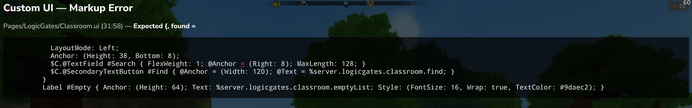

# Classroom rc.5 — falha de markup no cliente

Em 24/10/2026, o usuário relatou que, ao entrar no mundo aberto pelo Hytale, apareceu erro de Custom UI e não foi possível usar `/classroom`. A captura mostra `Pages/LogicGates/Classroom.ui (31:58) — Expected {, found =` na declaração `@Anchor` de Buscar, depois de `FlexWeight`.

A imagem não mostra o build ID ou checksum. A candidata entregue antes deste relato era `1.4.0-rc.5+af23d18990f0`, identificada no [registro automatizado](../../validation.md#polimento-e-autorização-automática--rc5); esse dado de entrega não é confirmação visual da identidade do JAR instalado.

A auditoria encontrou o mesmo padrão em Próxima (`@Text` após `FlexWeight`). A rc.6 coloca os parâmetros antes das propriedades, conforme os templates e páginas nativos 0.7.4, e acrescenta regressões/verificação das fontes e dos documentos empacotados. Não altera banco, turmas ou circuitos.

Os 810 testes JUnit, 32 Python e 78 verificações nativas da rc.5 continuam evidência das camadas exercitadas; não comprovavam a leitura dos documentos pelo cliente. A falha impede aprovar o polimento e a reação visual a permissões. O [roteiro rc.6](../../classroom-rc6-acceptance.md) começa por entrar, abrir, fechar e reabrir antes dos demais cenários.
