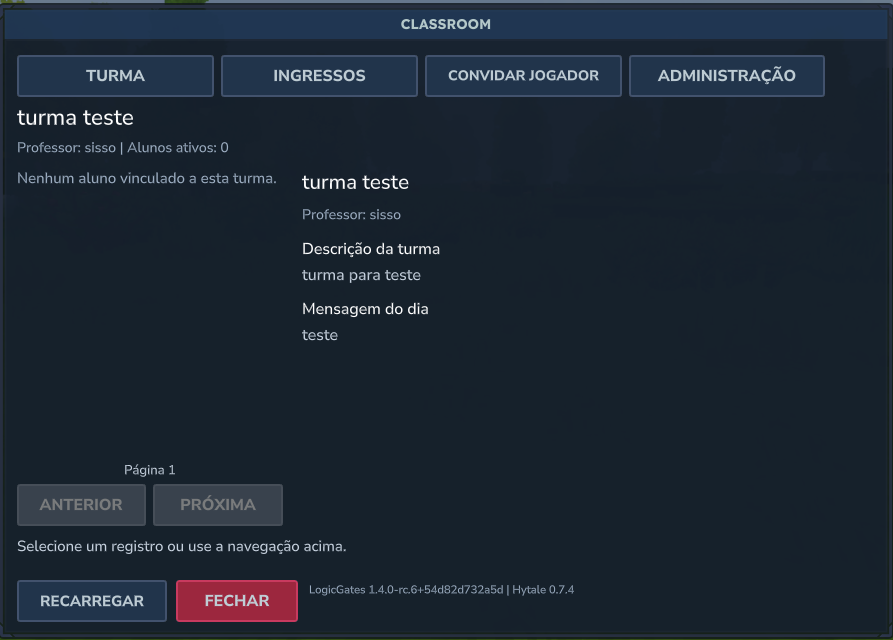

# Classroom rc.6 — abertura confirmada, aceite parcial

Em 24/10/2026, o usuário enviou quatro capturas e informou que não poderia fazer testes detalhados naquele momento. Os quatro arquivos são idênticos em bytes (SHA-256 `13cb54424d2853c841bce4365e9f13d51ebd5bc354574d09cd22564e458882ba`); apenas uma cópia representativa foi arquivada.

## Confirmado pela captura

- Classroom aberto no cliente, com identificação `LogicGates 1.4.0-rc.6+54d82d732a5d | Hytale 0.7.4` e textos em pt-BR. A leitura do documento e a renderização inicial desta página ocorreram; a falha de markup que bloqueou a rc.5 não se apresenta nesta abertura.
- Visão geral docente de `turma teste`, professor `sisso`, zero alunos ativos. Nome, professor, descrição `turma para teste` e mensagem `teste` estão carregados.
- Abas, título, metadados e texto vazio específicos legíveis. `Anterior` e `Próxima` aparecem completos, desabilitados; o contador `Página 1` ocupa linha própria. `Recarregar` e `Fechar` também estão visíveis.

O PNG mede 893 × 640; isso não comprova resolução do jogo ou escala de interface. O build ID está visível, mas o checksum do JAR instalado não foi informado. Dados carregados nesta tela não constituem por si só novo teste de reinício/persistência.

## Limites e continuação

As capturas mostram a mesma tela, sem sequência de interação. Não comprovam fechar/Esc/reabrir, alternância de abas, busca, seleção, paginação com registros, Administração/rolagem, formulários, painel do aluno, autorização automática ou preservação de rascunhos. En-US, resoluções/escala e os demais casos do [roteiro](../../classroom-acceptance.md#abertura-e-sessão) continuam pendentes. Os resultados históricos da rc.4 mantêm seu próprio escopo.

Há um ajuste de orientação identificado: o rodapé ainda pede “Selecione um registro ou use a navegação acima” quando a lista docente está vazia. O texto vazio da lista já é específico, mas a instrução do rodapé pode refletir melhor esse contexto; isso fica registrado para o polimento, sem tratar a abertura como aceite completo.

O trabalho desta rodada consolida somente evidência/documentação. A compilação rc.6 entregue permanece identificada no [registro de validação](../../validation.md#correção-de-markup--rc6). A rodada detalhada será retomada conforme a disponibilidade do usuário; nenhuma versão estável ou tag foi aprovada por estas capturas.
