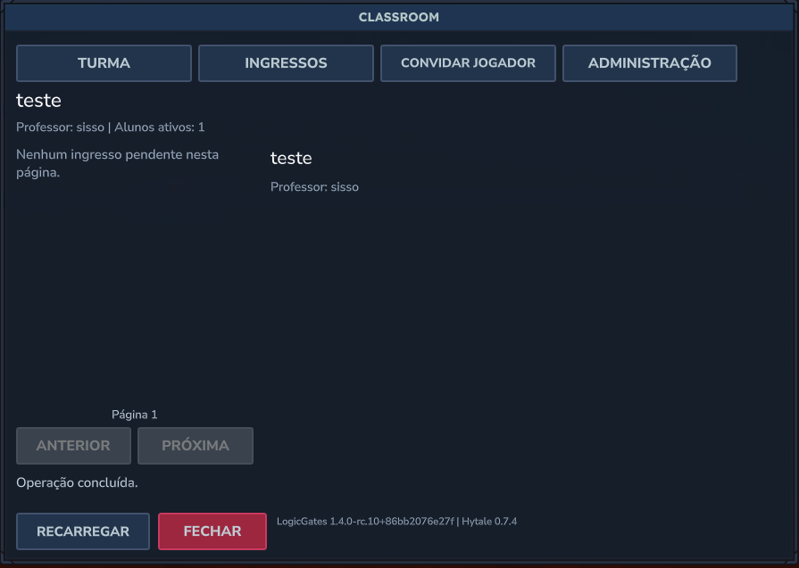
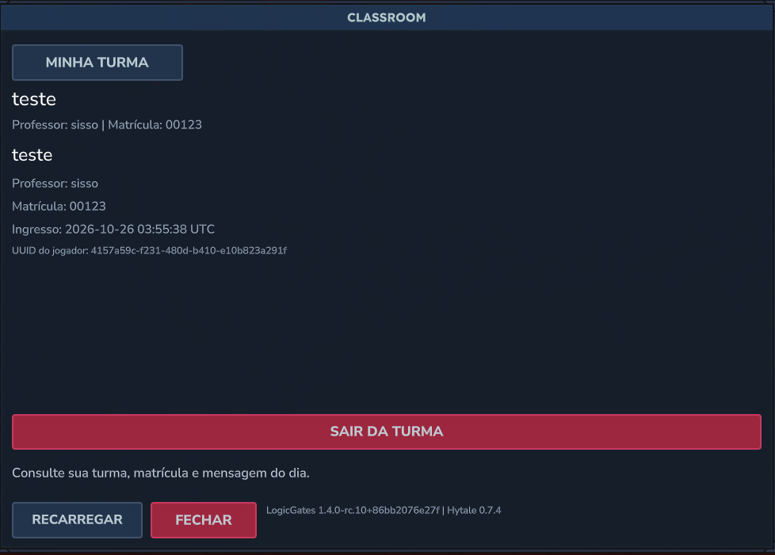

# Classroom rc.10 — regressão curta confirmada

Em 26/10/2026, o usuário relatou sucesso nos cinco testes propostos e anexou duas capturas distintas. Ambas mostram **`1.4.0-rc.10+86bb2076e27f`**, Hytale **0.7.4**, com textos em pt-BR. O checksum do JAR instalado não foi recalculado no cliente; a identidade do arquivo entregue permanece no [registro automatizado](../../validation.md#leituras-agregadas--rc10).

## Confirmado pelas capturas

O painel docente mostra a turma `teste`, professor `sisso`, **um aluno ativo**, lista sem ingresso pendente e status de operação concluída. A captura não mostra o aluno selecionado na lista de membros nem prova a sequência de atualização por si só.

O aluno vê a mesma turma/professor, **matrícula `00123`**, data/hora de ingresso UTC e UUID secundário, com a ação Sair da turma e orientação contextual. A matrícula conserva os zeros à esquerda.

Os PNGs medem 895×637 e 978×701. Essas dimensões não comprovam a resolução do jogo ou a escala de interface. São duas capturas diferentes, arquivadas integralmente, sem edição. SHA-256: docente `493ad1f85a1329592277411ac29dc82c036abd49f96c2079134f45db7f0dbe5d`; aluno `1af08d9fe3f5fb87d2b591cc42d453f04c5c4253faaf767cadde5b0bafde63b7`.

## Confirmado pelo relato de interação

| Teste | Resultado relatado |
| --- | --- |
| Troca de abas | Funcionamento perfeito e resposta instantânea. A demora inicial anterior não foi observada nesta rodada; não houve cronometragem nem discriminação por máquina |
| Solicitação e aprovação | Atualização automática tanto para professor quanto para aluno |
| Saída | Contagem de alunos diminuiu instantaneamente |
| Busca | Personagens corretos com filtro correspondente; consulta aleatória sem resultados |
| Edição durante atualização | Descrição permaneceu intacta e pôde ser salva |

As capturas complementam o relato, sem substituir a sequência que não foi gravada. Não atribuir isoladamente o resultado visual à otimização SQL: o usuário agora confirma o comportamento da candidata completa, que também contém as alterações anteriores de transporte.

## Pendências preservadas

Esta confirmação aprova os cinco cenários breves da rodada, não toda a versão estável. Continuam sem confirmação individual nesta candidata: paginação com mais de 20 registros, en-US e combinações de resolução/escala previstas, textos extensos/rolagem, revogação/restauração e descarte de rascunho, recusa/cancelamento, mensagem vazia, reabertura/reconexão e reinício/persistência. Os resultados históricos correspondentes continuam válidos dentro do escopo em que foram registrados. O [roteiro atual](../../classroom-acceptance.md#roteiro-administrativo) acompanha esses casos.

Nenhum código, JAR ou ZIP foi recompilado para incorporar este relato. Não representa aprovação de tag, publicação estável ou merge em `main`.
