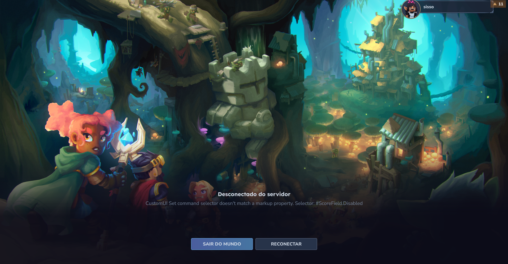

# rc.11 — bloqueio na abertura de Atividades

O usuário conseguiu conectar no mundo e abrir `/classroom`. Ao clicar em Atividades, a tela apareceu brevemente e ocorreu desconexão. A captura mostra:

> CustomUI Set command selector doesn't match a markup property. Selector: #ScoreField.Disabled

**Comprovado pela captura:** o cliente recusou o comando de Custom UI. **Confirmado pelo relato:** conexão e comando administrativo funcionaram; o erro ocorreu ao abrir Atividades. Não há log nesta evidência para afirmar encerramento do processo do servidor. O build ID não está visível na captura; a candidata entregue antes do teste era `1.4.0-rc.11+31e3c78c7881`, JAR SHA-256 `140d80eae81a91206567b120df4315a87de6ecd1991f656817f5b7e09b7a0c14`.

O código enviava `.Disabled` aos campos TextField e MultilineTextField na renderização, gravação e recuperação de erros. A rc.12 remove essas propriedades e conserva o bloqueio de ações/validação no servidor. Testes anteriores de abertura inicial e integração do servidor não exercitavam essa atualização no cliente. O [reteste da rc.12](../../classroom-acceptance.md#roteiro-com-professor-e-aluno) e os demais cenários de seleção/preview permanecem pendentes.
